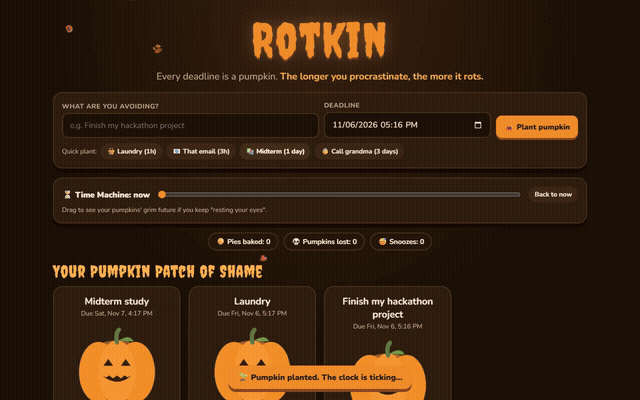
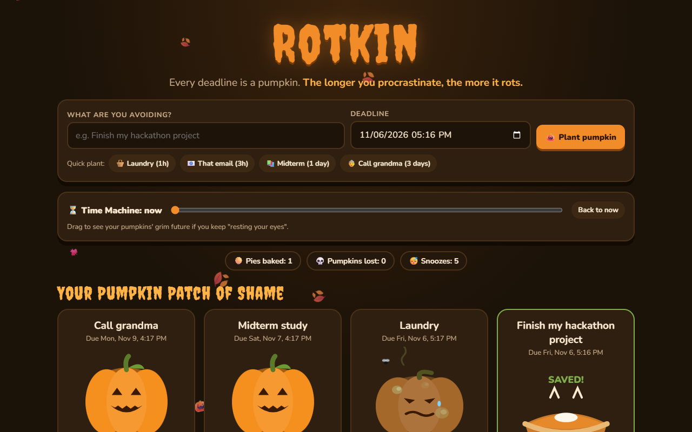
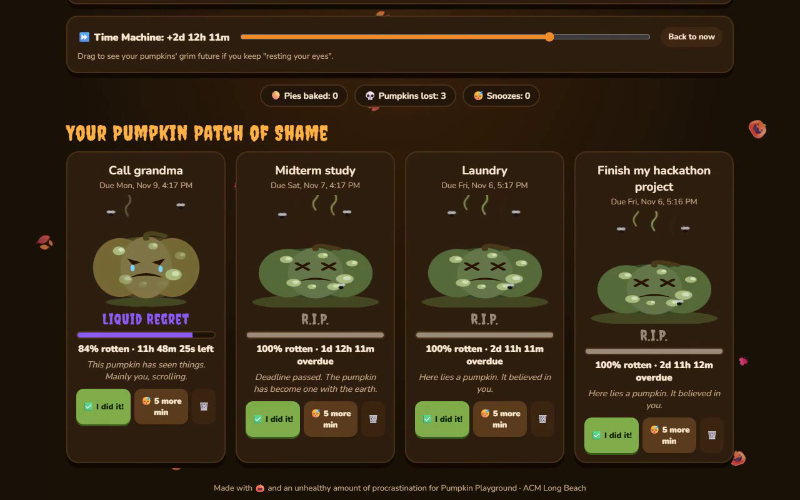

# 🎃 Rotkin

**Every deadline is a pumpkin. The longer you procrastinate, the more it rots.**

## What is this?

Rotkin is a procrastination meter that turns your to-do list into a pumpkin patch. Plant a pumpkin for each task you're avoiding, and watch it go from **Farm Fresh → Slightly Soft → Questionable → Science Project → Liquid Regret → R.I.P.** as the deadline gets closer.

## Features

- 🌱 **Plant a pumpkin** for any task + deadline (or use the quick-plant buttons)
- 🤢 **Live rotting**: color, shape, mold, stink lines, fruit flies and a sad face all react to how close the deadline is
- 💬 **Roasts**: each rot stage has a judgmental message (*"There is mold. The mold has a name. It's Kevin."*)
- 😴 **"5 more min"**: snoozing makes the pumpkin rot 12% faster out of pure disappointment
- ✅ **"I did it!"**: finished tasks turn into pumpkin pie 🥧 with confetti
- ⏩ **Time Machine**: preview your pumpkins' grim future if you keep "resting your eyes"
- 💾 Saves in your browser (localStorage), works on phone and desktop, no sign-up

## Video demo

## Run it

It's one file. Open `index.html` in any browser, or play the [live demo](https://aivietnam-aio-felixdoit.github.io/rotkin/).

## How it works

The pumpkin is an SVG drawn from a single **rot** value: time elapsed ÷ total time, plus a penalty for every snooze. That one number sets the color, the sag, the mold spots, the stem droop, the stink lines, the flies and the facial expression, so the pumpkin rots smoothly instead of jumping between pictures.

---

Made with 🎃 and an unhealthy amount of procrastination for <a href="https://pumpkin-playground.devpost.com/">Pumpkin Playground</a>.

